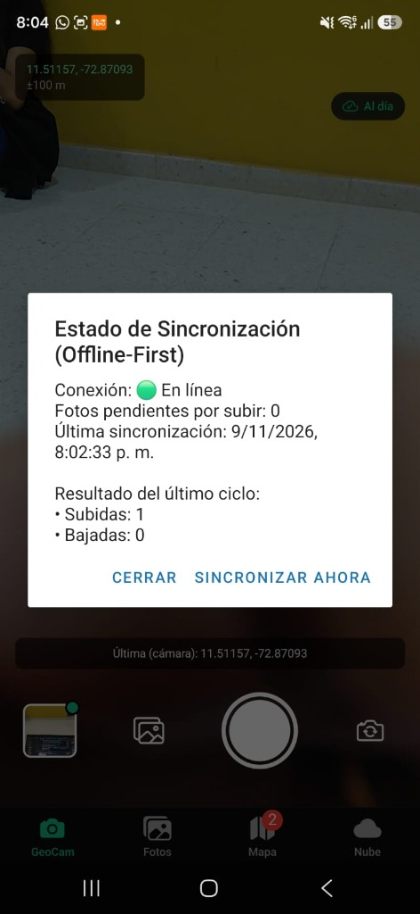
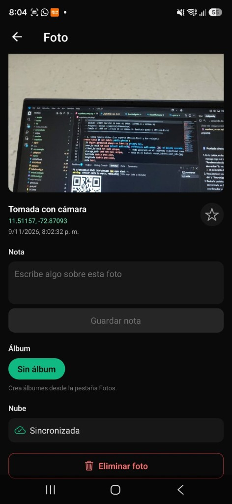
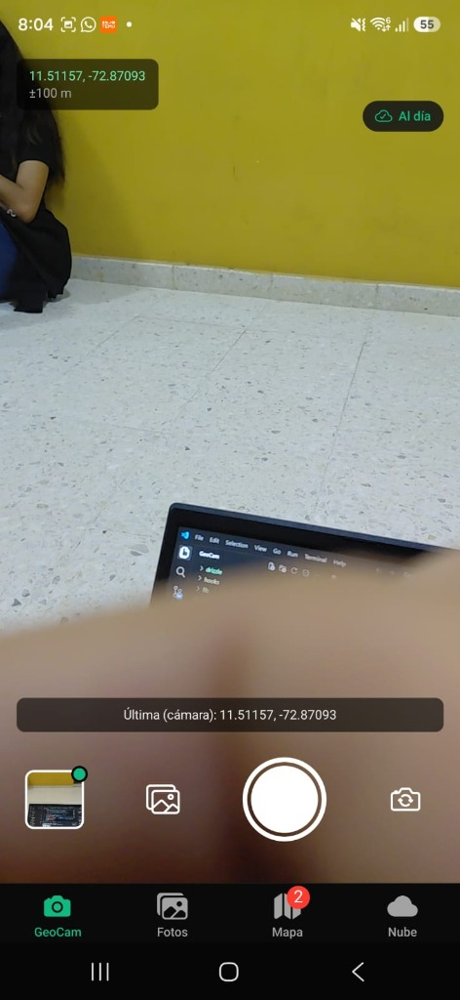
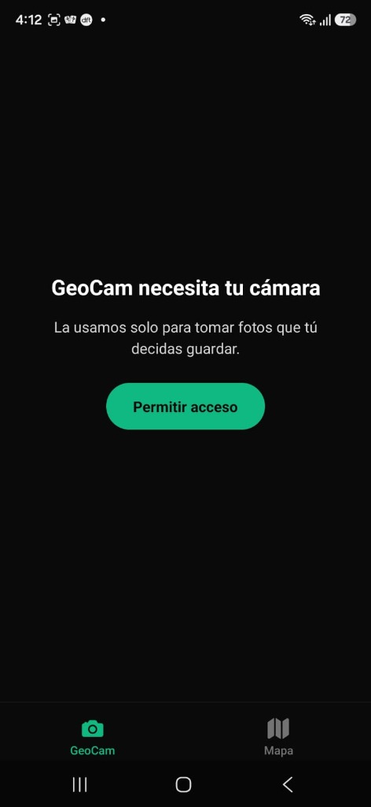
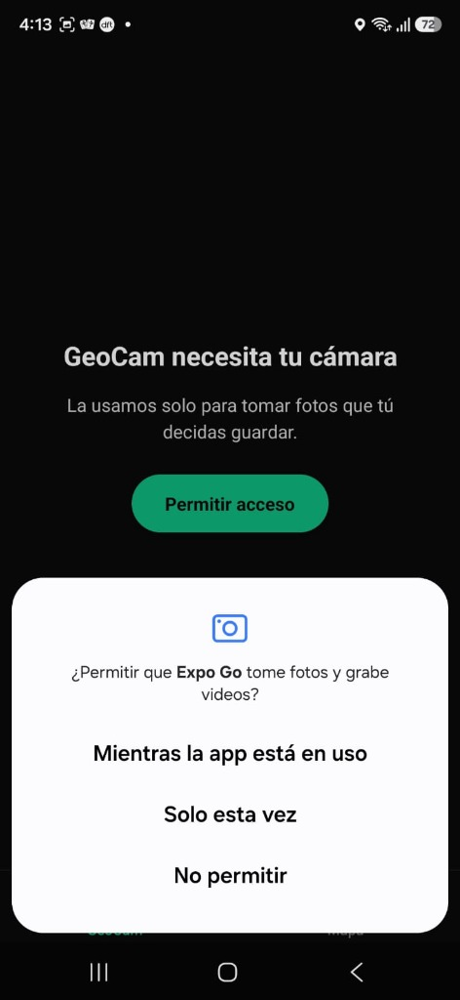
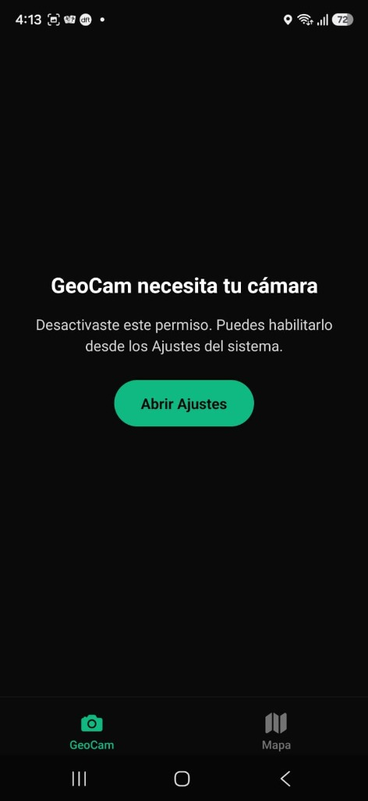
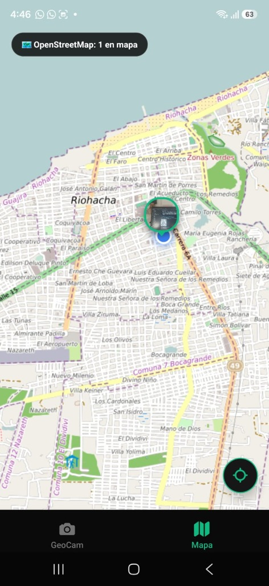
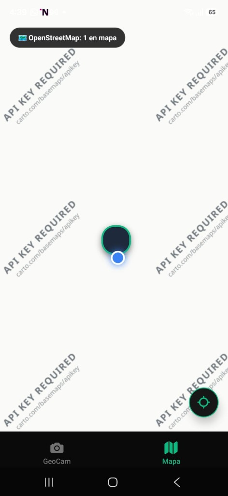
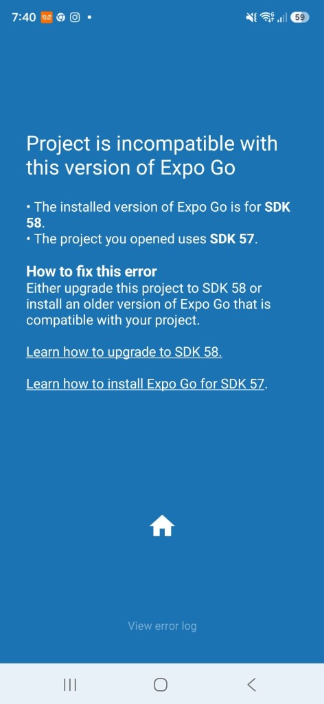

# GeoCam sincronizada 📍📷🔄
**Semana 9: TanStack Query y Sincronización Offline-First**  
**Desarrollado por:** Ramiro José Gómez Agámez y Álvaro Javier Pinto Sierra  
Programación Móvil Avanzada · Universidad de La Guajira

La aplicación trabaja de forma local y offline mediante SQLite (Drizzle ORM). Cuando el dispositivo recupera la conexión a internet, TanStack Query y el motor de sincronización suben automáticamente las fotos y notas pendientes a Supabase, y descargan las fotos creadas o modificadas en otros dispositivos con la misma cuenta.

---

## 🏗️ Arquitectura Offline-First

```text
┌────────────────────────────────────────────────────────┐
│                        UI                              │
│       GeoCamScreen · FotosScreen · MapaScreen          │
└───────────────────────────┬────────────────────────────┘
                            │ reactiva (useLiveQuery)
┌───────────────────────────▼────────────────────────────┐
│              SQLite Local (Drizzle ORM)                │
│                 Fuente de Verdad                       │
│    photos (clientId, updatedAt, syncedAt, note...)     │
│             sync_meta (lastPulledAt:userId)            │
└───────────────────────────┬────────────────────────────┘
                            │
               services/sync.ts (syncAll)
             Disparado por TanStack Query v5
               (onlineManager + focusManager)
                            │
┌───────────────────────────▼────────────────────────────┐
│               Supabase Cloud (PostgreSQL)              │
│       photos (client_id, updated_at, server_updated_at)│
│       storage.buckets ('geocam' privado por usuario)   │
└────────────────────────────────────────────────────────┘
```

---

## 🔄 Ciclo de Sincronización (`syncAll`)

Cada ciclo de sincronización en `services/sync.ts` ejecuta siempre dos pasos ordenados:

1. **BAJAR (`pull`)**:
   - Pide a Supabase las filas con `server_updated_at > lastPulledAt`.
   - Si no existe localmente: descarga el archivo del bucket mediante URL firmada y la inserta en SQLite (`syncedAt = remote.updatedAt`).
   - Si existe localmente: evalúa la regla de resolución de conflictos `remoteWins(local.updatedAt, remote.updated_at)`. Si la versión remota es más reciente, actualiza SQLite. Si la versión local es más nueva, no se toca (se subirá en el paso 2).
   - Avanza el cursor en `sync_meta`.
2. **SUBIR (`push`)**:
   - Consulta las fotos pendientes en SQLite: `syncedAt is null OR updatedAt > syncedAt`.
   - Sube el archivo binario al bucket privado `geocam` (con manejo de idempotencia si ya existe).
   - Realiza un `upsert` por `client_id` en la tabla `photos` de PostgreSQL.
   - Marca la foto en SQLite con `syncedAt = updatedAt` subido.

---

## ⚡ Disparadores Automáticos (TanStack Query)

`hooks/useSync.ts` expone la sincronización mediante TanStack Query:

| Disparador | Mecanismo |
| :--- | :--- |
| **Inicio de sesión o apertura de la app** | `enabled: !!userId` |
| **Recuperación de conexión a internet** | `refetchOnReconnect: 'always'` enlazado con `onlineManager` y `expo-network` |
| **Retorno a primer plano** | `refetchOnWindowFocus: 'always'` enlazado con `focusManager` y `AppState` |
| **Cambio local (foto, nota, favorita)** | `queryClient.invalidateQueries({ queryKey: ['sync'] })` |
| **Manual** | Presionar el `SyncBadge` en la barra superior |

---

## 🧪 Matriz de Pruebas (Semana 9 - C6)

| # | Escenario de Prueba | Resultado Esperado | Resultado Obtenido |
| :-: | :--- | :--- | :--- |
| **1** | **Foto tomada sin conexión; luego se reconecta** | Se sube sola; pendientes vuelve a 0. | ✅ Superado. `SyncBadge` pasa de "X pendientes" a "Al día" automáticamente al recuperar la red vía `onlineManager`. |
| **2** | **Foto creada en el teléfono A** | Aparece en el teléfono B con imagen y ubicación. | ✅ Superado. `pull()` descarga el binario del bucket privado vía URL firmada e inserta el registro en SQLite. |
| **3** | **Nota editada en A y después en B, ambos sin conexión** | En los dos queda la nota de B. | ✅ Superado. `remoteWins()` compara `updatedAt` y conserva la edición más reciente. |
| **4** | **Foto borrada en A** | Desaparece en B y del bucket. | ✅ Superado. Borrado lógico con `deleted_at` sincronizado entre dispositivos. |
| **5** | **Foto editada en A y borrada después en B, ambos sin conexión** | Queda borrada en los dos (el borrado es el último cambio). | ✅ Superado. La marca de borrado gana por timestamp `updatedAt`. |
| **6** | **Se corta la red a mitad de una sincronización de 5 fotos** | Al reconectar termina sin duplicar filas ni archivos (idempotencia y tolerancia C5). | ✅ Superado. Subida protegida con `onConflict: client_id` y reintento atómico de fotos pendientes. |
| **7** | **Se cierra la app con fotos pendientes y se abre con red** | Se sincroniza al abrir. | ✅ Superado. TanStack Query reanuda la consulta `['sync', userId]` y la caché sobrevive con AsyncStorage (C3). |

---

## 🌟 Funcionalidades Avanzadas Implementadas (Trabajo para la Casa)

- **C1. Borrado Lógico Sincronizado**: Soporte para `deleted_at` en Supabase y SQLite para evitar pérdidas de estado.
- **C2. Pestaña Nube (`app/(tabs)/nube.tsx`)**: Feed infinito con `useInfiniteQuery`, paginación por cursor (`created_at`), búsqueda con debounce (`useDebouncedValue`), y los 4 estados de UI (carga, sin datos y sin red, error con reintento, y éxito con caché offline).
- **C3. Persistencia de Caché**: Implementada con `@tanstack/react-query-persist-client` y `@tanstack/query-async-storage-persister` para que los datos sobrevivan al cierre de la app.
- **C4. Pantalla/Diálogo de Estado de Sincronización**: Accesible al pulsar el `SyncBadge`, mostrando fotos pendientes, fecha de la última sincronización, desglose de subidas/bajadas, último error y botón "Sincronizar ahora".
- **C5. Resiliencia y Errores por Foto**: Bloque `try...catch` independiente por cada foto en `push()`: si una foto individual falla, las demás continúan subiendo y la fallida queda para el próximo ciclo.

---

## ❓ Preguntas para Sustentar

### 1. ¿Por qué se baja antes de subir?
Porque si se subiera primero, un cambio local antiguo pendiente de sincronizar podría sobreescribir una modificación más reciente hecha en otro teléfono en la nube antes de poder compararlas. Al bajar primero, comparamos con `remoteWins()` y protegemos la versión más reciente.

### 2. ¿Para qué sirven dos columnas de fecha en la tabla remota y qué fallaría con una sola?
- `updated_at`: Representa el reloj del teléfono (cuándo editó el usuario). Sirve para decidir quién gana en un conflicto.
- `server_updated_at`: Representa el reloj del servidor PostgreSQL (generado por trigger al momento de inserción/actualización). Sirve como cursor de bajada (`pull`).
- *Fallo con una sola:* Si una foto se edita sin red el lunes y se sube el miércoles, tendrá `updated_at` de lunes. Si el cursor de bajada usara `updated_at`, un segundo teléfono que sincronizó el martes nunca la descargaría porque su cursor ya superó la fecha del lunes.

### 3. ¿Qué significa que la subida sea idempotente y por qué eso permite reintentar?
Idempotencia significa que ejecutar la misma operación una o diez veces produce exactamente el mismo resultado sin efectos secundarios adversos. El `upsert` por `client_id` y la subida de archivo al storage tolerando errores de existencia permiten que TanStack Query reintente peticiones fallidas sin crear registros duplicados.

### 4. ¿Por qué un borrado no puede ser un DELETE directo en un sistema sincronizado?
Porque un `DELETE` directo destruye la fila sin dejar ningún rastro en la base de datos remota. Los otros dispositivos nunca se enterarían de que el registro fue borrado y podrían volver a subirlo o mantenerlo huérfano. Para resolver esto se utiliza borrado lógico (`deleted_at`).

### 5. ¿Qué parte del trabajo hace TanStack Query y qué parte es diseño propio?
- **TanStack Query:** Gestiona la ejecución asíncrona, reintentos exponenciales, detección de foco y reconexión de red (`onlineManager` / `focusManager`), deduplicación de consultas y estado de UI (`isFetching`, `error`).
- **Diseño Propio:** El algoritmo de sincronización en dos sentidos (`pull` y `push`), la regla de resolución de conflictos (`remoteWins`), la persistencia en SQLite con Drizzle y la descarga/almacenamiento de archivos binarios.

---

## 📸 Evidencias y Capturas de Pantalla (`screenshots/`)

### ✅ Sincronización Exitosa y Funcionamiento en Dispositivo Real (Semana 9)

| Diálogo Estado Sincro (C4) | Foto Sincronizada en Supabase | GeoCam "Al día" en Línea |
| :---: | :---: | :---: |
|  |  |  |

### 🔍 Permisos y Diagnóstico Previo

| Permiso de Cámara (Sistema) | Permiso GeoCam | Manejo Permiso Denegado |
| :---: | :---: | :---: |
|  |  |  |

| Mapa OpenStreetMap (Riohacha, La Guajira) | Diagnóstico API Key Carto | Diagnóstico SDK 58 Expo Go |
| :---: | :---: | :---: |
|  |  |  |

---

## 🚀 Puesta en Marcha

1. Asegúrate de tener el archivo `.env` configurado con tus credenciales de Supabase:
   ```env
   EXPO_PUBLIC_SUPABASE_URL=https://ywmgiccnjvblmneuiupn.supabase.co
   EXPO_PUBLIC_SUPABASE_PUBLISHABLE_KEY=sb_publishable_...
   ```
2. Ejecuta el SQL de la Semana 9 en Supabase (`supabase/semana9.sql`).
3. Inicia la aplicación en Expo:
   ```bash
   npx expo start -c
   ```
